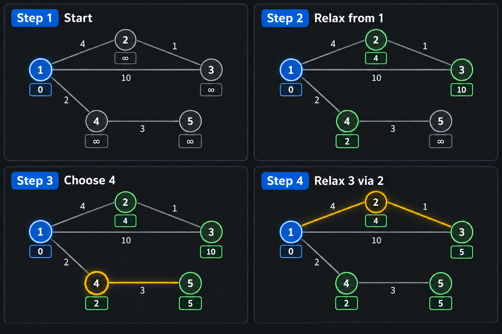

# 다익스트라

## 1. 다익스트라란?

다익스트라는 **가중치가 있는 그래프에서 한 시작점부터 다른 모든 정점까지의 최단 거리**를 구하는 알고리즘이다.

도로마다 이동 시간이 다르고, 한 도시에서 다른 도시로 이동할 때 가장 빠른 경로를 찾아야 하는 문제에 자주 사용한다.

단, 간선의 가중치가 음수이면 사용할 수 없다. 모든 이동 비용이 0 이상이어야 한다.

## 2. 왜 다익스트라를 사용하는가?

최단 경로를 구할 때 모든 경로를 직접 확인하면 같은 경로를 반복해서 확인하게 되고 경우의 수가 매우 커진다. 다익스트라는 현재까지 가장 짧은 거리가 확정되지 않은 정점 중 가장 가까운 정점을 먼저 선택한다.

한 번 선택된 정점의 거리는 더 짧아질 수 없다는 성질을 이용하므로, 불필요한 경로를 모두 탐색하지 않아도 된다.

### 다른 방법과 비교

| 방법 | 적합한 상황 | 한계 |
|---|---|---|
| BFS | 모든 간선의 비용이 같을 때 | 가중치가 다르면 최단 거리를 보장하지 못함 |
| 다익스트라 | 간선 가중치가 0 이상이고 한 시작점에서 최단 거리를 구할 때 | 음수 가중치를 처리할 수 없음 |
| 벨만-포드 | 음수 가중치가 있을 때 | 다익스트라보다 느림 |
| 플로이드-워셜 | 모든 정점 쌍의 최단 거리를 구할 때 | 정점 수가 크면 `O(V^3)`으로 부담이 큼 |

즉, 간선마다 이동 비용이 다르지만 음수 비용은 없고, 한 출발점에서 여러 정점까지의 최단 거리를 구해야 한다면 다익스트라를 우선 의심한다.

## 3. 어떤 코테 문제에서 다익스트라를 의심해야 할까?

다음 표현이 나오면 다익스트라를 떠올릴 수 있다.

- 도시, 컴퓨터, 지점, 노드 사이를 이동한다.
- 도로, 간선, 통신 비용, 이동 시간에 숫자가 붙어 있다.
- 한 지점에서 다른 모든 지점까지 걸리는 최소 시간이나 최소 비용을 구한다.
- “가장 빠르게”, “최소 비용으로”, “최단 거리”, “전파가 전달되는 최소 시간”을 묻는다.
- 이동 비용이 음수가 아니고, 정점과 간선의 수가 BFS만으로 처리하기에는 크다.

### 예시: 통신 전파 시간

> 컴퓨터 1에서 신호를 보낸다. 각 연결에는 신호가 전달되는 시간이 있다. 모든 컴퓨터가 신호를 받는 데 걸리는 최소 시간을 구하라.



그림에는 컴퓨터 1, 2, 3, 4, 5가 있다. 1번에서 3번으로 바로 가면 10초가 걸리지만, 1 → 2 → 3으로 이동하면 `4 + 1 = 5`초가 걸린다. 또한 1 → 4 → 5로 이동하면 `2 + 3 = 5`초가 걸린다.

이 문제는 단순히 연결된 간선의 개수를 세는 문제가 아니다. 간선마다 시간이 다르므로 BFS보다 다익스트라가 적합하다.

다익스트라는 다음처럼 생각한다.

1. 시작점 1의 거리는 `0`으로 두고, 2·3·4·5번은 `∞`로 둔다.
2. 1번에서 연결된 2·3·4번의 거리를 각각 `4`, `10`, `2`로 갱신한다.
3. 가장 가까운 4번을 꺼내 5번까지의 거리를 `2 + 3 = 5`로 갱신한다.
4. 2번을 꺼내 3번의 거리를 `10`에서 `4 + 1 = 5`로 갱신한다.
5. 모든 컴퓨터를 확인하면 최종 거리는 `[0, 4, 5, 2, 5]`이다.

## 4. 핵심 아이디어: 거리 완화

현재 정점 `now`에서 이웃 정점 `next`로 이동한다고 하자.

```text
새 거리 = 현재 정점까지의 거리 + 현재 정점에서 다음 정점까지의 비용
```

새 거리가 기존에 저장된 거리보다 짧다면 갱신한다.

```java
if (distance[next] > distance[now] + cost) {
    distance[next] = distance[now] + cost;
}
```

이 과정을 **거리 완화(Relaxation)** 라고 한다. 코드로는 다음처럼 읽으면 된다.

```text
distance[next] > distance[now] + cost
→ 새 경로로 가는 것이 기존 경로보다 더 짧은가?

distance[next] = distance[now] + cost
→ 더 짧다면 다음 정점까지의 최단 거리 후보를 새 값으로 바꾼다.
```

## 5. 우선순위 큐를 사용하는 이유

다익스트라는 매번 “현재까지 거리가 가장 짧은 정점”을 골라야 한다. 정점을 매번 배열에서 찾으면 정점이 많을 때 느려질 수 있다.

자바의 `PriorityQueue`를 사용하면 가장 작은 거리를 가진 상태를 빠르게 꺼낼 수 있다.

자바의 `PriorityQueue`는 기본적으로 작은 값부터 꺼내는 최소 힙이다. `(거리, 정점)`을 배열로 저장하고 거리 기준으로 정렬하면 된다.

```java
PriorityQueue<int[]> pq = new PriorityQueue<>(
    (a, b) -> Integer.compare(a[0], b[0])
);
```

```text
a[0] → a 상태의 거리
b[0] → b 상태의 거리
Integer.compare(a[0], b[0])
→ 거리가 작은 상태가 먼저 나오게 정렬한다.
```

## 6. 자바 구현

```java
import java.util.*;

public class Main {
    static class Edge {
        int to;
        int cost;

        Edge(int to, int cost) {
            this.to = to;
            this.cost = cost;
        }
    }

    public static int[] dijkstra(List<Edge>[] graph, int start) {
        int n = graph.length;
        int[] distance = new int[n];
        Arrays.fill(distance, Integer.MAX_VALUE);

        PriorityQueue<int[]> pq = new PriorityQueue<>(
            (a, b) -> Integer.compare(a[0], b[0])
        );

        distance[start] = 0; // 시작점까지의 거리는 0이다.
        pq.offer(new int[]{0, start}); // {현재 거리, 현재 정점}을 넣는다.

        while (!pq.isEmpty()) {
            int[] current = pq.poll(); // 가장 거리가 짧은 상태를 꺼낸다.
            int currentDistance = current[0];
            int currentNode = current[1];

            if (currentDistance > distance[currentNode]) {
                continue; // 이미 더 짧은 거리로 처리했다면 오래된 상태를 버린다.
            }

            for (Edge edge : graph[currentNode]) {
                int nextNode = edge.to;
                int newDistance = currentDistance + edge.cost;

                if (newDistance < distance[nextNode]) {
                    distance[nextNode] = newDistance; // 더 짧은 경로를 찾으면 갱신한다.
                    pq.offer(new int[]{newDistance, nextNode}); // 갱신된 상태를 다시 탐색한다.
                }
            }
        }

        return distance;
    }
}
```

## 7. 구현 예시와 출력

다음 그래프에서 1번 컴퓨터부터 각 컴퓨터까지의 최단 거리를 구한다고 하자.

아래 그림처럼 시작점 1번 컴퓨터의 거리를 0으로 두고, 연결된 컴퓨터의 거리를 차례대로 갱신한다.


그림의 흐름은 다음과 같다.

1. 1번 컴퓨터의 거리를 `0`으로 설정하고 나머지는 `∞`로 둔다.
2. 1번에서 연결된 2번, 3번, 4번의 거리를 각각 `4`, `10`, `2`로 갱신한다.
3. 현재 거리 `2`로 가장 가까운 4번 컴퓨터를 선택하고, 5번까지의 거리를 `2 + 3 = 5`로 갱신한다.
4. 거리 `4`인 2번을 선택한 뒤 `2 → 3`을 확인한다. `4 + 1 = 5`가 기존 `10`보다 작으므로 3번 거리를 `5`로 갱신한다.
5. 이후 3번과 5번을 확인하면 최종 거리 `[0, 4, 5, 2, 5]`가 완성된다.

```java
// 간선: 1 -> 2 (4), 1 -> 3 (10), 1 -> 4 (2), 2 -> 3 (1), 4 -> 5 (3)
// 결과: 1번 컴퓨터에서 각 컴퓨터까지의 최단 거리
// distance[1] = 0
// distance[2] = 4
// distance[3] = 5  // 1 -> 2 -> 3: 4 + 1
// distance[4] = 2
// distance[5] = 5  // 1 -> 4 -> 5: 2 + 3
```

출력 결과는 다음과 같다.

```text
[0, 4, 5, 2, 5]
```

1번에서 3번으로 바로 가는 경로가 있어도, 1 → 2 → 3 경로가 더 짧으면 그 경로로 거리를 갱신한다. 또한 1 → 4 → 5처럼 새로 확정한 정점을 거쳐 다른 정점의 거리도 계속 갱신한다.

## 8. 오래된 우선순위 큐 상태를 건너뛰는 이유

한 정점의 거리가 갱신되면 우선순위 큐에 이전 거리와 새로운 거리가 모두 들어갈 수 있다.

```java
if (currentDistance > distance[currentNode]) {
    continue;
}
```

이 조건은 다음 의미이다.

```text
큐에서 꺼낸 거리 > 현재 기록된 최단 거리
→ 더 짧은 경로를 이미 찾았으므로 이 상태는 오래된 정보이다.
→ 다시 탐색하지 않고 건너뛴다.
```

이 조건을 넣지 않으면 같은 정점을 불필요하게 여러 번 탐색해 시간이 늘어날 수 있다.

## 9. 시간 복잡도와 공간 복잡도

- 인접 리스트 + 우선순위 큐: `O((V + E) log V)`
- 인접 리스트 공간: `O(V + E)`
- 거리 배열과 우선순위 큐: `O(V)` 이상

`V`는 정점 수, `E`는 간선 수이다. 코딩 테스트에서는 보통 인접 행렬보다 인접 리스트와 우선순위 큐 조합을 사용한다.

## 10. 주의할 점

- 음수 간선이 있으면 다익스트라를 사용할 수 없다.
- 거리의 합이 `int` 범위를 넘을 수 있으면 `long`을 사용한다.
- 도달할 수 없는 정점은 `Integer.MAX_VALUE`로 남을 수 있으므로 출력 전에 확인한다.
- 무방향 그래프라면 `a -> b`와 `b -> a` 간선을 모두 추가한다.
- 우선순위 큐에는 보통 `{거리, 정점}` 순서로 넣고 거리 기준으로 정렬한다.
- 인접 리스트를 만들 때 모든 정점의 리스트를 초기화해야 한다.

## 11. 학습 문제

- [프로그래머스 - 배달](https://school.programmers.co.kr/learn/courses/30/lessons/12978): 마을 사이의 이동 시간이 주어지고 1번 마을에서 갈 수 있는 마을 수를 구하는 문제이다.
- [프로그래머스 - 합승 택시 요금](https://school.programmers.co.kr/learn/courses/30/lessons/72413): 두 사람이 일정 구간까지 함께 이동한 뒤 나누어 이동할 때 최소 요금을 구하는 문제이다.
- [프로그래머스 - 가장 먼 노드](https://school.programmers.co.kr/learn/courses/30/lessons/49189): 모든 간선의 비용이 같아 BFS로 풀 수 있지만, 가중치가 있는 최단 경로 문제와 비교해 볼 수 있다.
