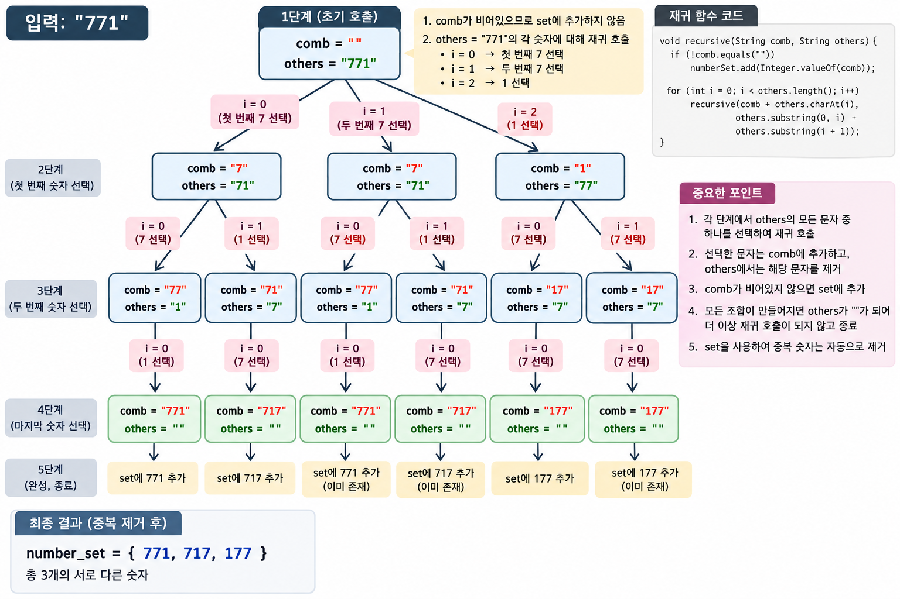

# 재귀함수

## 1. 재귀함수란?

재귀함수는 함수 안에서 자기 자신을 다시 호출하는 함수이다. 큰 문제를 같은 모양의 작은 문제로 나누고, 더 이상 나눌 수 없는 지점에서 호출을 멈춘다.

재귀함수에는 기저 조건과 재귀 호출이 반드시 필요하다.

```java
static void countdown(int number) {
    if (number == 0) { // 기저 조건: 0이면 멈춘다.
        return;
    }
    System.out.println(number);
    countdown(number - 1); // 더 작은 문제로 다시 호출한다.
}

countdown(3);
// 출력: 3, 2, 1
```

## 2. 왜 재귀함수를 사용하는가?

반복문으로도 풀 수 있지만, 문제의 구조가 “현재 상태에서 여러 선택 중 하나를 고르고 다음 상태로 이동”하는 형태라면 재귀가 더 자연스럽다.

- 순열, 조합, 부분집합 등 선택의 깊이가 달라지는 완전 탐색에 적합하다.
- 백트래킹에서 현재 선택과 다음 선택의 관계를 표현하기 쉽다.
- 트리와 그래프의 DFS를 자연스럽게 나타낼 수 있다.
- 분할 정복처럼 큰 문제를 같은 형태의 작은 문제로 나눌 수 있다.

단순 반복은 반복문이 더 간단하며, 재귀 깊이가 너무 깊으면 스택 오버플로가 발생할 수 있다.

## 3. 어떤 코테 문제에서 재귀를 의심할까?

- 각 단계에서 여러 선택지 중 하나를 고르는 문제
- 모든 경우의 수를 확인하는 문제
- 선택한 값은 현재 경로에서 다시 사용할 수 없는 문제
- 순열, 조합, 부분집합, 미로, N-Queen, 완전 탐색, 백트래킹 문제

## 4. 소수 찾기 예시

숫자 문자열 `"771"`이 주어졌을 때, 숫자를 일부 또는 전부 사용해 만들 수 있는 서로 다른 소수의 개수를 구한다고 하자.

한 자리, 두 자리, 세 자리 숫자를 모두 만들기 위해 아직 사용하지 않은 숫자 중 하나를 고르고 다음 단계로 내려간다.



그림에서 한 단계 내려갈 때마다 선택한 숫자는 `temp`에 붙고, `others`에서는 제거된다.

## 5. `temp`와 `others`의 의미

```java
combination(temp, others)
```

- `temp`: 지금까지 선택해서 만든 숫자
- `others`: 아직 선택하지 않은 숫자

```java
combination("7", "71");
```

위 호출은 “현재 숫자는 7이고, 아직 사용할 수 있는 숫자는 7과 1이다”라는 뜻이다.

```text
7 선택 → temp = "77", others = "1"
1 선택 → temp = "71", others = "7"
```

호출이 한 번 내려갈 때마다 `temp`는 한 글자 길어지고 `others`는 한 글자 짧아진다.

## 6. 코드 한 줄씩 이해하기

```java
public void combination(String temp, String others) {
    if (!temp.equals("")) {
        int num = Integer.valueOf(temp); // 문자열을 정수로 바꾼다.

        if (isPrime(num)) {
            set.add(num); // Set은 같은 숫자를 한 번만 저장한다.
        }
    }

    for (int i = 0; i < others.length(); i++) {
        combination(
            temp + others.charAt(i),
            others.substring(0, i) + others.substring(i + 1)
        );
    }
}
```

### 현재 숫자가 비어 있지 않으면 검사한다

처음 호출에서는 `temp`가 빈 문자열이므로 숫자로 변환하지 않는다. `temp`가 `"7"`, `"77"`, `"717"`처럼 값이 생기면 소수인지 검사한다.

### 아직 사용하지 않은 숫자를 하나 고른다

`others = "71"`이면 `i = 0`에서 7을 고르고, `i = 1`에서 1을 고른다. 모든 선택지를 재귀호출로 내려보낸다.

### 선택한 숫자를 붙이고 제거한다

```java
temp + others.charAt(i)
```

현재 숫자 뒤에 선택한 숫자를 붙인다. 예를 들어 `temp = "7"`, 선택한 문자가 `1`이면 결과는 `"71"`이다.

```java
others.substring(0, i) + others.substring(i + 1)
```

`others = "771"`, `i = 1`이면 앞부분 `"7"`과 뒷부분 `"1"`을 이어 `"71"`을 만든다. 선택한 두 번째 `7`은 목록에서 제거된다.

## 7. 호출 흐름

```java
combination("", "771");
```

```text
combination("", "771")
├─ 7 선택 → combination("7", "71")
│  ├─ 7 선택 → combination("77", "1")
│  │  └─ 1 선택 → combination("771", "")
│  └─ 1 선택 → combination("71", "7")
│     └─ 7 선택 → combination("717", "")
└─ 1 선택 → combination("1", "77")
```

`others`가 빈 문자열이 되면 `for`문이 실행되지 않아 현재 호출이 종료된다. 이 코드에서는 `others.length() == 0`인 상태가 기저 조건 역할을 한다.

`771`처럼 같은 숫자가 있으면 같은 숫자가 여러 경로에서 만들어질 수 있으므로 `Set`으로 중복을 제거한다.

## 8. Java 전체 예시

```java
import java.util.HashSet;
import java.util.Set;

class Solution {
    private final Set<Integer> set = new HashSet<>();

    public int solution(String numbers) {
        combination("", numbers); // 아무 숫자도 선택하지 않은 상태에서 시작한다.
        return set.size(); // 중복 제거 후 소수의 개수이다.
    }

    private void combination(String temp, String others) {
        if (!temp.equals("")) {
            int number = Integer.valueOf(temp); // 현재 문자열을 정수로 변환한다.
            if (isPrime(number)) {
                set.add(number); // 소수만 저장한다.
            }
        }

        for (int i = 0; i < others.length(); i++) {
            char selected = others.charAt(i); // 사용하지 않은 숫자를 고른다.
            String nextTemp = temp + selected; // 선택한 숫자를 붙인다.
            String nextOthers = others.substring(0, i) + others.substring(i + 1); // 선택한 숫자를 제거한다.
            combination(nextTemp, nextOthers); // 다음 선택 단계로 내려간다.
        }
    }

    private boolean isPrime(int number) {
        if (number < 2) return false;
        for (int divisor = 2; divisor * divisor <= number; divisor++) {
            if (number % divisor == 0) return false;
        }
        return true;
    }
}
```

## 9. 복잡도와 주의점

숫자 개수를 `N`이라고 하면 각 길이의 순열을 탐색하므로 재귀 탐색은 대략 `O(N!)` 수준으로 증가한다. 소수 판별은 숫자를 `M`이라고 할 때 `O(√M)`이다. 재귀 스택은 최대 `O(N)`이다.

- 기저 조건 없이 호출하면 무한 재귀가 발생한다.
- 선택한 문자를 `others`에서 제거하지 않으면 같은 문자를 중복 사용한다.
- 빈 `temp`를 정수로 변환하면 예외가 발생한다.
- `Set`을 사용하지 않으면 같은 숫자를 여러 번 센다.

## 10. 학습 문제

- [프로그래머스 - 소수 찾기](https://school.programmers.co.kr/learn/courses/30/lessons/42839): 숫자를 조합해 모든 경우를 탐색하는 문제이다.
- [프로그래머스 - 타겟 넘버](https://school.programmers.co.kr/learn/courses/30/lessons/43165): 각 숫자에 `+` 또는 `-`를 선택하는 재귀 문제이다.
- [프로그래머스 - 단어 변환](https://school.programmers.co.kr/learn/courses/30/lessons/43163): 현재 상태에서 다음 상태로 이동하는 DFS 문제이다.
